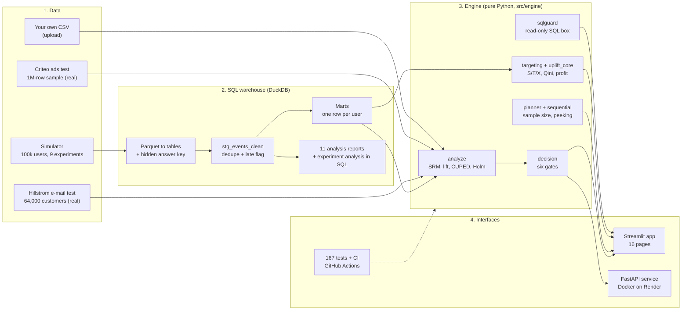
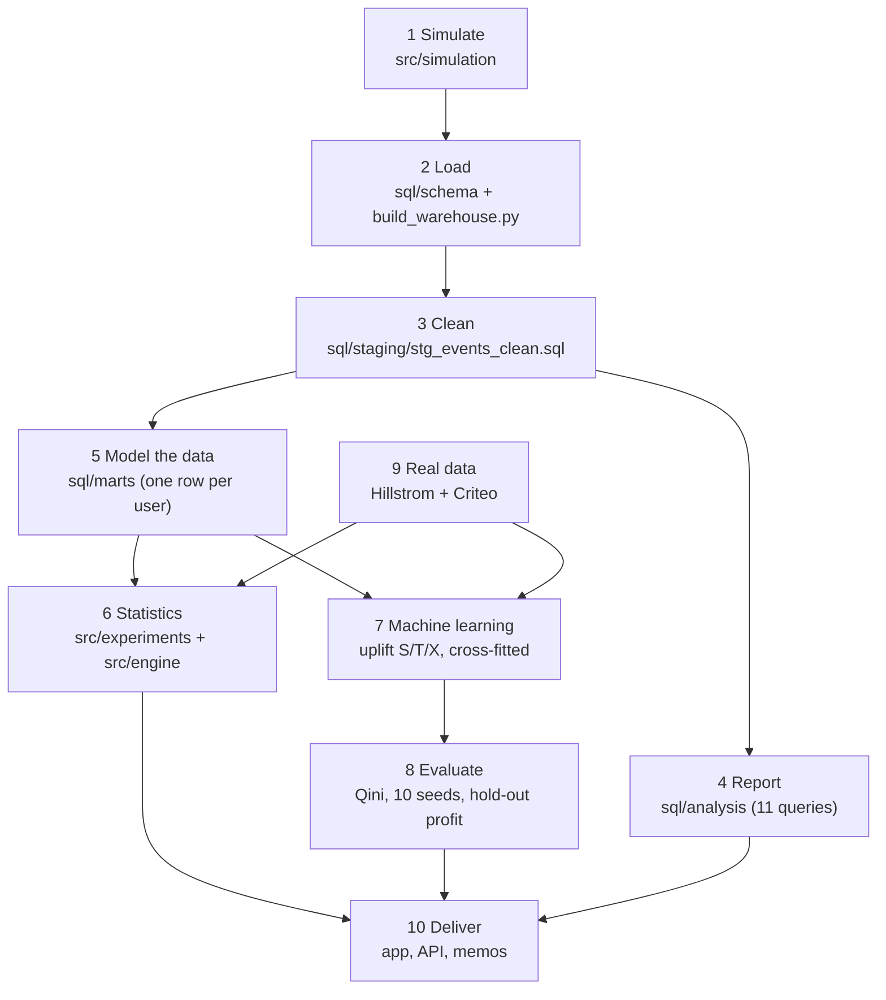

# Growth Experimentation Platform

**Turn any A/B-test table into a trust-checked decision: SHIP, ITERATE, INCONCLUSIVE or DO NOT TRUST, with the reasons, the money, and (when it makes sense) which users should get the change.**

[](https://github.com/DeepShah111/growth-experimentation-platform/actions/workflows/ci.yml)


## Live links

| | Link | What it is |
|---|---|---|
| **Live app** | **https://growth-experimentation-platform.streamlit.app** | The interactive web app (16 pages). Start here. |
| **REST API docs** | **https://growth-experimentation-platform.onrender.com/docs** | The same engine as a REST service (Docker on Render). Try the endpoints in the browser. |
| API health | https://growth-experimentation-platform.onrender.com/health | Should answer `{"status":"ok","version":"2.0.0"}` |
| Source code | https://github.com/DeepShah111/growth-experimentation-platform | This repository |
| Detailed project guide (PDF) | [docs/Growth_Experimentation_Platform_Project_Guide.pdf](docs/Growth_Experimentation_Platform_Project_Guide.pdf) | 86-page guide: every concept, every page, every parameter |

> **Free hosting note.** Both services run on free tiers and go to sleep when idle. The first visit after a quiet period can take **about a minute** to wake up; after that it is fast. Open the links a few minutes before showing them to anyone.

---

## Table of contents

1. [What this project is](#1-what-this-project-is)
2. [Try it in two minutes](#2-try-it-in-two-minutes)
3. [Architecture](#3-architecture)
4. [The data and ML pipeline, stage by stage](#4-the-data-and-ml-pipeline-stage-by-stage)
5. [The data](#5-the-data)
6. [The SQL layer](#6-the-sql-layer)
7. [A/B-testing and statistics methods](#7-ab-testing-and-statistics-methods)
8. [Uplift modelling (who should get the offer)](#8-uplift-modelling-who-should-get-the-offer)
9. [Results](#9-results)
10. [The live app, page by page](#10-the-live-app-page-by-page)
11. [The REST API](#11-the-rest-api)
12. [Docker and deployment](#12-docker-and-deployment)
13. [Quick start: run everything on your computer](#13-quick-start-run-everything-on-your-computer)
14. [Testing and continuous integration](#14-testing-and-continuous-integration)
15. [Project structure](#15-project-structure)
16. [Design decisions](#16-design-decisions)
17. [Limits and honesty](#17-limits-and-honesty)
18. [Roadmap](#18-roadmap)
19. [Data sources and attribution](#19-data-sources-and-attribution)
20. [Author](#20-author)

---

## 1. What this project is

Companies change their products constantly (a new checkout button, a different homepage, a discount e-mail). Before shipping a change to everyone they test it on a random part of their users and compare against a group that did not get it: an **A/B test**. Running the test is easy. **Reading it correctly is hard**:

- the split of users can be silently broken, which fakes a win;
- a real effect can be missed because the sample was too small;
- checking the dashboard daily turns a 5% false-positive rate into roughly 20 to 28%;
- run 20 harmless tests and about 6 in 10 times one looks like a winner;
- a statistically real win can still lose money once costs are counted;
- an average win can hide users who are actively harmed.

The **Growth Experimentation Platform** is a referee for experiments. It checks that the split was fair, measures the lift with honest uncertainty, reduces noise with pre-experiment data (CUPED), corrects for multiple tests, checks that the test could have seen the effect at all (power), checks guardrail metrics, checks unit economics, and finally returns one decision with the reasons. A second part uses **uplift models** to estimate, per user, how much extra a treatment causes, and decides how many users are worth reaching.

It is built around three questions:

| # | Question | How the platform answers it |
|---|---|---|
| 1 | **Can we trust the result?** | Sample-ratio check, data-quality monitor, peeking and multiple-testing controls, power analysis, and a validation of the platform's *own* statistics in 100 re-simulated worlds. |
| 2 | **What should ship?** | A scorecard with six ordered gates (trust, evidence, power, safety, validity, economics). |
| 3 | **Who should get the offer?** | S, T and X uplift learners with cross-fitting, honest hold-out profit, and a profit curve at *your* value and cost. |

### Real data and a simulator (and why both)

- A **simulator** of a grocery-delivery app (100,000 users, 84 days, **nine experiments with hidden, known true effects** and planted problems) is a **test bench**: because the truth is known, the platform can be graded. It is *not* presented as evidence about the real world.
- **Two real randomised datasets** run through the same engine: the **Hillstrom e-mail test** (64,000 customers) and the **Criteo ads test** (1,000,000-user sample).

### What is in the box

- A **DuckDB SQL warehouse** with a cleaning layer, per-user marts, **11 analysis reports** and a **complete experiment analysis written in SQL** that matches the Python engine to nine digits.
- A **statistics engine** (pure Python functions): SRM, CUPED, Holm, power/MDE, peeking, novelty, interaction, heavy-tailed revenue, guardrails, unit economics, and the decision rule.
- **Uplift models** (S/T/X learners, cross-fitting, Qini, hold-out profit, multi-seed stability).
- A **generic engine** (`src/engine/`) that analyses *any* experiment table, including a CSV you upload.
- A **16-page interactive Streamlit app**, a **FastAPI REST service** packaged with **Docker**, **167 automated tests**, and **CI on GitHub Actions**.

---

## 2. Try it in two minutes

Open the [live app](https://growth-experimentation-platform.streamlit.app) and try these. Each one shows a different idea:

| Do this | What you should see | The idea |
|---|---|---|
| **Analyze an experiment**: keep Hillstrom, outcome `conversion`. | Men's e-mail **SHIP**, Women's e-mail **ITERATE**. | A lift can be real and still not worth shipping. |
| Same page: raise **Cost of treating one user** from 0.15 to 0.50. | Both cards become **ITERATE**. | Evidence and economics together make the decision. |
| Same page: lower the cost to 0.05. | Both cards return to **SHIP**. | The decision flips when the profit interval crosses zero. |
| Same page: choose dataset **Simulated app**, experiment **exp_006**, then open "Reveal the planted truth". | **DO NOT TRUST** (sample-ratio mismatch). | A broken assignment fakes a win; the platform refuses to read it. |
| **Plan an experiment**: baseline 5%, lift 10%, 2 arms. | **31,231 users per arm**, 5 weeks at 2,000 users a day. | Halve the lift and you need about 4x the users. |
| **Peeking simulator**: move the slider from 1 to 10 looks. | False wins rise from 5% to about 19 to 20%. | Looking early inflates false wins. |
| **Live targeting**: Hillstrom, outcome `spend`. | A warning that no model clearly beats random targeting. | The platform says "no" when targeting is not worth it. |
| **SQL workbench**, tab "Experiment analysis in pure SQL". | "SQL and Python agree to 9 digits." | The same analysis in two languages. |
| **SQL workbench**, tab "Write your own": run `DROP TABLE users`. | It is refused. | A safe, read-only public SQL box. |

The same engine is available over HTTP: open the [API docs](https://growth-experimentation-platform.onrender.com/docs), choose `POST /plan`, click **Try it out** and send `{"kind":"rate","baseline":0.05,"rel_lift":0.1}`; the answer is `n_per_arm: 31231`.

---

## 3. Architecture

Four layers. Data flows left to right; decisions come out on the right.



**The idea behind the layers.** The notebooks, the command-line scripts, the REST API and the Streamlit app all call the *same pure functions* in `src/engine/`. That is why the Analyze page and the API can never disagree, and why a test can check the SQL result against the Python result to nine digits.

**Two independent deployments from one repository:**

| | Streamlit app | REST API |
|---|---|---|
| Purpose | The interactive demo | The engine as a service other programs can call |
| Built from | `app/streamlit_app.py`, `app/live_pages.py` | `api/main.py` + `Dockerfile` |
| Hosted on | Streamlit Community Cloud | Render (Docker, free instance) |
| Depends on the other? | No: it runs the engine in-process | No |

---

## 4. The data and ML pipeline, stage by stage



| # | Stage | Goes in, comes out | Where |
|---|---|---|---|
| 1 | **Simulate** | Config to 7 Parquet tables (about 85 MB) | `src/simulation/` |
| 2 | **Load** | Parquet to DuckDB tables; the hidden answer key lives in a separate schema | `sql/schema/`, `src/warehouse/build_warehouse.py` |
| 3 | **Clean** | `events` to `stg_events_clean`: 5,275,310 raw events become 5,243,847 | `sql/staging/` |
| 4 | **Report** | Clean tables to 11 SQL result CSVs | `sql/analysis/`, `src/warehouse/run_sql.py` |
| 5 | **Model the data** | One row per assigned user: outcomes after assignment, features from the 28 days before | `sql/marts/` |
| 6 | **Statistics** | Marts to a decision per experiment | `src/experiments/`, `src/engine/` |
| 7 | **Machine learning** | Marts to an uplift score per user (S, T, X learners; 4-fold cross-fitting) | `src/targeting/`, `src/engine/uplift_core.py` |
| 8 | **Evaluate** | Scores to honest numbers: Qini area, bootstrap intervals, 10 seeds, hold-out profit | `src/targeting/` |
| 9 | **Real data** | Criteo sample and Hillstrom through the same checks | `src/criteo/`, `src/engine/` |
| 10 | **Deliver** | Artifacts, memos, the API and the Streamlit app | `app/`, `api/`, `docs/memos/` |

### How the machine-learning part works

- **Goal.** Estimate each user's *causal* response to a treatment (uplift), not their purchase probability.
- **Features (8, all known before the experiment):** `orders_pre`, `revenue_pre`, `sessions_pre`, `days_since_signup`, `is_new`, and the categories `device`, `channel`, `city`. A test guards against leakage: outcomes, the treatment flag and anything from the answer key can never become features.
- **Learners:** gradient-boosted trees (scikit-learn `HistGradientBoostingRegressor`; 150 trees, depth 4, minimum 200 users per leaf, L2 = 1.0; Poisson loss for counts). Settings were fixed, not tuned.
  - **S-learner:** one model with the treatment flag as a feature; uplift = prediction with the flag on minus off.
  - **T-learner:** one model for treated users, one for control; uplift = the difference.
  - **X-learner:** imputes each user's missing outcome with the two models, regresses the imputed effects, and blends with the propensity.
- **Cross-fitting:** 4 folds; every user is scored by a model that never saw them.
- **Evaluation on randomised data:** a per-user pseudo-effect `tau_i = y_i * (t_i/p - (1-t_i)/(1-p))` (its average is the treatment effect). Sorting users by score and cumulating `tau_i` gives a Qini-style gain curve; the **Qini area** (extra outcome per 1,000 users over random targeting) is the metric, with bootstrap intervals.
- **Money:** `profit(k) = value * (extra outcome from the top k users) - cost * k`. The best cut-off is picked on one random half of users and scored on the other half (**hold-out profit**), because picking it on the same data is optimistic.
- **Stability:** the whole evaluation is repeated with 10 seeds and a paired bootstrap compares learners.

---

## 5. The data

### 5.1 Simulated warehouse (the test bench)

Seven tables for a fictional grocery-delivery app. Day 0 is a Monday (5 Jan 2026); days 0 to 27 are a **pre-period** with no experiments.

| Table | One row is... | Main columns |
|---|---|---|
| `users` | a user | `user_id, signup_date, is_new, city, device, channel` |
| `products` | a product (300) | `product_id, category` |
| `sessions` | a visit | `session_id, user_id, session_start, duration_sec, device` |
| `events` | something that happened | `event_id, session_id, user_id, event_type, event_ts, product_id, ingested_at` |
| `orders` | a purchase | `order_id, session_id, user_id, order_ts, n_items, gross_value, discount_pct, order_value` |
| `experiments` | an experiment | `experiment_id, name, start_date, end_date, primary_metric, exclusive_group` |
| `assignments` | a user in an experiment | `assignment_id, experiment_id, user_id, variant, assigned_at` |

The **answer key** (`answer_key.ground_truth`, `answer_key.user_truth`) lives in its own schema so no analysis query can touch it by accident.

**Planted problems:** about 0.60% duplicate events, about 1.51% events that arrive more than a day late, an assignment bug in exp_006 that drops low-activity treated users, and two experiments (exp_001, exp_004) that overlap on the same surface.

**The nine experiments and their hidden truths**

| ID | Name | Hidden truth | What it tests |
|---|---|---|---|
| exp_001 | checkout_button_v2 | Constant +8%; overlaps exp_004 | A clear win |
| exp_002 | delivery_fee_banner | Constant +1.5% | A tiny effect: is the sample big enough? |
| exp_003 | recs_carousel | Exactly 0 | A true null |
| exp_004 | homepage_redesign | +12% fading to +1%; overlaps exp_001 | A novelty effect |
| exp_005 | onboarding_flow | +18% for new users only | A segment-only effect |
| exp_006 | search_ranking_v3 | 0, with a planted assignment bug | Must be flagged DO NOT TRUST |
| exp_007 | free_delivery_threshold | +6% on basket value | A heavy-tailed revenue metric |
| exp_008 | winback_offer_profile | Lift depends on channel and device | A costly offer; learnable uplift |
| exp_009 | personalised_offer_latent | Lift depends on a hidden segment | Deliberately hard |

Business assumptions (not measurements): **INR 50 contribution per extra order** and **INR 3 per user shown the win-back offer**.

### 5.2 Hillstrom e-mail test (real, randomised)

64,000 customers randomly split into **Men's e-mail** (21,307), **Women's e-mail** (21,387) and **No e-mail** (21,306). Outcomes two weeks later: `visit`, `conversion`, `spend`. Pre-experiment columns: `recency, history, mens, womens, newbie`. Caveats: 2008 data, one retailer, spend is zero for about 99% of customers. A copy is committed at `sample_data/hillstrom.csv.gz` (about 0.4 MB) so the live app has real data.

### 5.3 Criteo ads uplift test (real, randomised)

Criteo Uplift v2.1 (13,979,592 rows in full): about 85% of users targeted and 15% held out at random, 12 anonymised features, outcomes `visit` and `conversion`. The project uses a random **1,000,000-row sample**. Only about 3.6% of treated users actually saw an ad, so all effects are **per user assigned** (analysing by exposure would break the randomisation).

---

## 6. The SQL layer

All SQL is in `sql/`, one file per query, each with a unit test against a hand-computed answer.

| Layer | Files | What it does |
|---|---|---|
| `schema/` | `00_schema.sql` | Loads Parquet into tables; hidden answer key in its own schema |
| `staging/` | `stg_events_clean.sql` | `ROW_NUMBER()` removes exact duplicates; flags events that arrive more than a day late |
| `marts/` | `experiment_user_metrics.sql`, `experiment_user_weekly.sql` | One row per assigned user: outcomes after assignment, 28-day pre-period covariates, profile; and per-exposure-week orders |
| `analysis/` | 11 reports (below) + `experiment_in_sql.sql` | Business reports and a full CUPED experiment analysis in SQL |

**The 11 analysis reports**

| Report | Technique | Question it answers |
|---|---|---|
| `activity_streaks` | Gaps and islands | Longest run of consecutive active days per user |
| `daily_revenue_trends` | Running `SUM() OVER`, 7-day moving average frame, `LAG` | Daily revenue, day-over-day and week-over-week change |
| `data_quality_events` | Conditional aggregation | Duplicate and late-event rates per day |
| `experiment_interaction` | Self-join, 2x2 design | Does A work the same with and without B? |
| `funnel_by_device` | `MAX(flag)` per session | Where do users drop off, by device? |
| `overlapping_experiments` | Self-join on time | Which experiments share a surface and users? |
| `rfm_segments` | `RANK`-based scoring, `CASE` | Champions, loyal, at-risk, lost customers |
| `sessionization_check` | `LAG` + running `SUM` | Would rebuilt sessions match the logged ones? |
| `srm_counts` | Conditional counts | Users per arm for every experiment |
| `top_products_per_category` | `DENSE_RANK` + `QUALIFY` | Top 3 carted products per category |
| `weekly_retention` | Cohorts, a grid of observable (cohort, week) pairs | Retention by signup week without censoring bias |

**SQL concepts used:** CTEs, window functions (`ROW_NUMBER`, `RANK`, `DENSE_RANK`, `LAG`, running sums, frames), `QUALIFY`, self-joins, conditional aggregation and `FILTER`, `LEFT JOIN` + `COALESCE`, `range()` grids, date functions, `NULLIF`/`CASE`, statistical aggregates (`COVAR_SAMP`, `VAR_SAMP`), views, schemas, parameters, `EXPLAIN`.

**The whole experiment analysis in SQL.** `sql/analysis/experiment_in_sql.sql` computes the CUPED coefficient (`COVAR_SAMP / VAR_SAMP`), the adjusted outcome, the relative lift and its delta-method interval inside the database. A test and the SQL workbench page check that SQL and the Python engine agree to nine digits.

**Two SQL bugs found by reading and fixed**
- RFM scoring used `NTILE`, which splits users with identical values (most buyers have one order) into different scores by `user_id`. Now rank-based, with a test of eight tied buyers.
- Retention counted cohorts that could not yet have been observed at week 8. Now a grid of observable weeks with explicit zeros, with two tests.

---

## 7. A/B-testing and statistics methods

| Method | Problem | What the platform does |
|---|---|---|
| **Sample-ratio mismatch (SRM)** | A 46/54 split instead of 50/50 means assignment is broken | Chi-square test against the planned split (any number of arms, unequal plans allowed). `p < 0.001` = DO NOT TRUST; `p < 0.10` = borderline note. |
| **Lift and uncertainty** | A ratio of two noisy averages | Relative lift with a **delta-method** interval and a Welch t-test p-value |
| **CUPED / regression adjustment** | Users differ hugely; that noise widens intervals | Subtracts the part of the outcome predicted by pre-experiment columns; mean unchanged, variance times `(1 - rho^2)`. Multi-covariate version by regression. |
| **Multiple testing** | 20 tests give about a 64% chance of a false winner | **Holm** across experiments (and across treatment arms); Bonferroni and Benjamini-Hochberg available |
| **Power, MDE, sample size** | Underpowered tests say "no effect" when they mean "unknown" | Closed-form sizing for rates and means, MDE for a fixed sample, power curves, validated by simulation |
| **Peeking and sequential testing** | Stopping at the first p below 0.05 inflates false wins | Simulation of naive, Bonferroni and **O'Brien-Fleming** rules (boundary calibrated by Monte Carlo) |
| **Novelty effects** | A lift that fades after week 1 | Lift by exposure week (each user's own clock) and a per-user slope trend test |
| **Interaction** | Overlapping experiments may not add | 2x2 table; interaction = effect of A when B on minus when B off |
| **Heavy-tailed revenue** | A few huge baskets dominate the mean | Naive, CUPED, winsorised (one pooled cap), bootstrap; purchase-rate x basket decomposition |
| **Guardrails** | A win that hurts another metric | A significantly worse guardrail blocks shipping |
| **Unit economics** | A real lift can lose money | Profit per user with an interval; provably negative blocks shipping |

### The decision rule

Six gates, in order. A gate that stops the process means the later gates are not read.

| Decision | When |
|---|---|
| **DO NOT TRUST** | Sample-ratio `p < 0.001`: assignment is broken |
| **DO NOT SHIP (harmful)** | Significantly negative lift |
| **SHIP** | Significant positive lift and no blocker |
| **ITERATE** | Significant, but a guardrail is worse, an interaction is found, the effect is fading, or it is provably unprofitable |
| **INCONCLUSIVE (underpowered)** | Not significant and the sample could not detect a lift as small as the worth-shipping bar: *unknown, not zero* |
| **NO EFFECT FOUND** | Not significant and the test could have detected the bar |

The thresholds (significance level, worth-shipping bar, SRM level) are arguments, not hidden constants.

### Validating the platform itself

`src/experiments/validation.py` re-simulates the app with a fresh seed and repeats the whole analysis **100 times** (20,000 users each) for experiments with a constant, known truth, plus the bug experiment on purpose. It checks bias, standard-error honesty, 95% interval coverage (with Wilson intervals), rejection rate and the CUPED gain. The validation code is itself tested by feeding it deliberately broken inputs.

---

## 8. Uplift modelling (who should get the offer)

Why not just predict who will buy? A purchase model finds people who would buy anyway. Uplift estimates the **causal** effect per user and separates four kinds of user:

| Type | Buys without the offer? | Buys with it? | Send the offer? |
|---|---|---|---|
| Persuadable | No | Yes | **Yes** |
| Sure thing | Yes | Yes | No (wasted cost) |
| Lost cause | No | No | No |
| Sleeping dog | Yes | No | **Never** (it drives them away) |

See [section 4](#how-the-machine-learning-part-works) for the method. The platform is deliberately honest about *when targeting does not help*: on the real Hillstrom data no uplift model clearly beats random targeting, and the Live targeting page says so instead of forcing a story.

---

## 9. Results

### 9.1 Scorecard on the simulator (100,000 users, graded against the hidden truth)

| Experiment | Decision | Hidden truth | Verdict |
|---|---|---|---|
| exp_001 checkout button | **SHIP** (+11.1%, 95% interval +8.0% to +14.3%) | +8% | Right |
| exp_002 delivery-fee banner | INCONCLUSIVE | +1.5% | Defensible (built underpowered) |
| exp_003 recs carousel | INCONCLUSIVE | 0 | Defensible |
| exp_004 homepage redesign | SHIP | +12% fading to +1% | **Miss:** weekly noise too large to see the fade |
| exp_005 onboarding flow | INCONCLUSIVE | +18% for new users only | **Miss:** a segment-only effect |
| exp_006 search ranking | **DO NOT TRUST** | 0, planted assignment bug | Right |
| exp_007 free-delivery threshold | SHIP | +6% basket value | Right |
| exp_008 win-back offer | **ITERATE** | Varies by channel and device | Right: real lift, unprofitable for everyone |
| exp_009 personalised offer | INCONCLUSIVE | Hidden-segment effect | Defensible |

Counts: SHIP 3, ITERATE 1, INCONCLUSIVE 4, DO NOT TRUST 1. The two misses are about *heterogeneity* (an effect for one segment, or one that fades), which the scorecard does not examine. They are documented, not hidden.

### 9.2 Platform validation (100 re-simulated worlds)

Clean experiments are **unbiased**; 95% interval coverage is **94% to 100%**; the planted-bug experiment is **flagged** (average error roughly +13% to +19%, coverage near zero).

### 9.3 The win-back offer (exp_008, assumed economics)

| Question | Answer |
|---|---|
| Overall lift | +7.1% (95% interval +4.4% to +9.8%) |
| Send to everyone | **INR -1.29 per user** (interval -2.03 to -0.55), about INR -129,000 per 100,000 users |
| Send to the S-learner's top slice (cut-off chosen on one half, scored on the other) | **INR 1,107 per 1,000 users** (INR 1,260 on the same users, the optimistic figure) |
| Other models, same method | X-learner INR 944, T-learner INR 647, random targeting INR -138 per 1,000 |
| Stability | S-learner scored 22.6 extra orders per 1,000 users vs random (sd 1.2 across seeds) and was best of the three in 10 of 10 seeds |
| Who benefits (S-learner, by predicted tenth) | Lowest tenth **-0.158** extra orders per user (harmed); next four tenths near zero; top tenth **+0.242** |
| Break-even | Sending to everyone only pays if an order is worth about INR 88, or the offer costs under about INR 1.71 per user |

Recommendation (in `docs/memos/`): do **not** send to everyone; send to roughly the top 24% ranked by the S-learner; then run a fresh randomised test of that policy before rollout (listed as not yet done).

### 9.4 Hillstrom e-mail test (real data, through the generic engine)

Arm sizes 21,306 / 21,307 / 21,387, **sample-ratio p = 0.904** (clean split). No covariates, Holm across the two e-mails:

| Outcome | Arm | Relative lift (95% interval) | Holm-adjusted p |
|---|---|---|---|
| Conversion | Men's e-mail | +118.8% (+72.2% to +165.5%) | 3.0e-13 |
| Conversion | Women's e-mail | +54.3% (+19.3% to +89.3%) | 1.6e-4 |
| Spend | Men's e-mail | +117.9% (+54.4% to +181.4%) | 2.3e-7 |
| Spend | Women's e-mail | +65.0% (+14.9% to +115.1%) | 1.1e-3 |

- **Adjusting for the five pre-experiment columns barely helps spend** (interval about 0.3% narrower): spend is zero for almost everyone. The platform reports this instead of claiming a variance-reduction win.
- **No uplift model beats random targeting** on this data (every bootstrap interval for the difference from random includes zero), so the right call is "e-mail everyone if the economics pay", not "build a targeting model".
- With the app's default economics (USD 30 per conversion, USD 0.15 per e-mail) Men's e-mail ships and Women's e-mail turns to ITERATE. These economics are assumptions you can change on the page.

### 9.5 Criteo ads test (real data, 1M-user sample)

- All 12 features are slightly unbalanced between treated and control (largest standardised difference 0.052; perfect randomisation would give about 0.003). Small but systematic, so the naive estimate is a little biased.
- **Naive vs doubly-robust effect:** visits +1.15 vs **+0.83 percentage points** (the naive number is inflated by 28%); conversion +0.12 vs +0.11 points (13%).
- **Who responds:** the top predicted decile gains about 6 points of visits and holds about **72%** of incremental visits (a first-pass method said 82%; the robust figure is the one to quote).

---

## 10. The live app, page by page

16 pages in a left-hand menu. Every page opens with three short sentences: *What this does*, *Why it matters*, *How to use it*.

### Interactive pages (change a control, the answer changes)

| Page | What it does | Main controls |
|---|---|---|
| **Analyze an experiment** | Trust-checked decision per treatment arm on Hillstrom, Criteo (if its sample is present), the simulator, or your own CSV | Dataset, outcome, pre-experiment columns, guardrail, significance level, worth-shipping bar, unit economics (value, cost, currency), planned split |
| **Plan an experiment** | Users, days and weeks a test needs; power curve; what you can detect in a fixed time | Baseline, smallest lift, arms, alpha, power, CUPED correlation, users per day, days available |
| **Peeking simulator** | False-win rates for naive, Bonferroni and O'Brien-Fleming rules | Number of looks (1 to 30), significance level |
| **Live targeting** | Cross-fitted S/T/X models, profit curve, hold-out profit and an honest verdict | Dataset, treatment arm, outcome, value, cost, model |
| **SQL workbench** | Run the project's SQL live, the pure-SQL experiment analysis, or your own read-only SQL | Query, experiment, SQL text, EXPLAIN |

### Results pages

| Page | What it shows |
|---|---|
| **Overview** | The three questions, four headline numbers and every experiment at a glance |
| **How it works** | The data-and-model flow, the nine steps and the ML models in plain words |
| **SQL layer** | The original SQL reports on the full 100,000-user data, with the SQL and a chart of each result |
| **Decision scorecard** | One row per experiment, the decision, the reasons and the comparison with the hidden truth |
| **Trust checks** | Sample-ratio split, naive vs adjusted vs truth, data-quality monitor |
| **Statistics lab** | Power, peeking, many experiments, novelty and overlap, revenue tails |
| **Who gets the offer?** | exp_008 uplift in four tabs: which model, who benefits, does it pay (sliders), is it stable |
| **Real data (Criteo)** | Balance, naive vs adjusted effects, who responds |
| **Platform validation** | The platform's own statistics checked over 100 simulated worlds |
| **Decision memos** | The ship memo (exp_001) and the targeting memo (exp_008) |
| **Limits and honesty** | What the project does not show |

The interactive pages call `src/engine/` directly. The Analyze page's simulator uses a 12,000-user in-memory warehouse so it loads in seconds; because the sample is smaller, some verdicts differ from the Scorecard page (for example exp_007 is INCONCLUSIVE at 12,000 users but SHIP at 100,000).

The results pages read only small committed files (`artifacts/`, `sql/`, `assets/`, `docs/memos/`), so the deployed app needs no database server and no large data.

---

## 11. The REST API

Run locally with `uvicorn api.main:app --reload` and open `http://127.0.0.1:8000/docs`, or use the deployed service at https://growth-experimentation-platform.onrender.com/docs.

| Endpoint | Input | Returns |
|---|---|---|
| `GET /health` | none | `{"status":"ok","version":"2.0.0"}` |
| `GET /datasets` | none | Bundled datasets, their columns, and whether they are available |
| `POST /analyze` | JSON: `records`, `variant`, `outcome`, `covariates`, `config` | SRM result and one decision object per treatment arm |
| `POST /analyze/csv` | CSV upload (multipart) plus the same mapping as form fields | Same as `/analyze` |
| `POST /plan` | `kind` (`rate` or `mean`), `baseline`, `rel_lift`, `sd`, `alpha`, `power`, `rho`, `daily_users`, `n_arms` | Users per arm, total, days, weeks, and a power curve |
| `POST /peeking` | `n_looks`, `alpha`, `n_sims` | False-positive rate per stopping rule |

**`config` fields** (all optional): `control`, `alpha` (0.05), `srm_alpha` (0.001), `min_effect` (0.03), `power` (0.8), `planned_split` (arm to share), `value_per_unit`, `cost_per_treated`, `currency`, `guardrail`.

**Example: plan a test**

```bash
curl -X POST https://growth-experimentation-platform.onrender.com/plan \
  -H "Content-Type: application/json" \
  -d '{"kind":"rate","baseline":0.05,"rel_lift":0.1,"daily_users":2000}'
```

```json
{"n_per_arm": 31231, "total_users": 62462, "alpha_used": 0.05, "days": 32, "weeks": 5, "power_curve": [ ... ]}
```

**Example: analyse an experiment**

```bash
curl -X POST https://growth-experimentation-platform.onrender.com/analyze \
  -H "Content-Type: application/json" \
  -d '{
        "records": [{"variant":"control","orders":1,"orders_pre":2}, {"variant":"treatment","orders":2,"orders_pre":1}],
        "variant": "variant", "outcome": "orders", "covariates": ["orders_pre"],
        "config": {"control": "control", "min_effect": 0.03}
      }'
```

(Use real data in practice; every arm needs at least 30 users.) The response has `srm` (`p_value`, `counts`, `expected`, `ok`) and `arms`, a list with `arm, n_treat, n_ctrl, lift, ci_low, ci_high, p_adj, mde, decision, reasons`, and profit fields when `value_per_unit` is set.

**Behaviour you can rely on**
- Inputs are validated (Pydantic). A bad request returns **422** with a readable message, for example `control arm 'nope' not found; arms in the data: [...]`.
- Limits protect the free server: 200,000 JSON records, 30 MB or 1,000,000 rows per CSV upload. **Nothing is stored.**
- Do not upload personal data to a public demo.

---

## 12. Docker and deployment

### The Docker image (API)

The `Dockerfile` at the repository root:

```dockerfile
FROM python:3.12-slim
ENV PYTHONDONTWRITEBYTECODE=1 PYTHONUNBUFFERED=1 PORT=8000
WORKDIR /app
COPY api/requirements.txt api/requirements.txt
RUN pip install --no-cache-dir -r api/requirements.txt     # dependencies first: fast rebuilds
COPY src/ src/
COPY sql/ sql/
COPY api/ api/
COPY sample_data/ sample_data/
RUN useradd --create-home appuser && chown -R appuser /app
USER appuser                                                # does not run as root
HEALTHCHECK ... /health
CMD ["sh", "-c", "uvicorn api.main:app --host 0.0.0.0 --port ${PORT}"]
```

- A slim Python image, dependencies installed before the code so rebuilds are quick, a **non-root user**, a **health check**, and the **port read from the environment** (so Render can set its own).
- `.dockerignore` keeps `.git`, `.venv`, `data/`, `artifacts/`, `notebooks/`, `tests/`, `docs/` and `app/` out of the image.

```bash
docker build -t gep-api .
docker run -p 8000:8000 gep-api
curl http://127.0.0.1:8000/health
```

### Where it is deployed

| Piece | Host | Settings |
|---|---|---|
| **Streamlit app** | Streamlit Community Cloud | Repository `DeepShah111/growth-experimentation-platform`, branch `main`, main file `app/streamlit_app.py`; dependencies from `app/requirements.txt`; redeploys on every push |
| **REST API** | Render (Web Service, **Docker** runtime, **Free** instance) | Built from the root `Dockerfile`; health check path `/health`; Render supplies `PORT`; redeploys on every push to `main` |

Both are free tiers: they **sleep when idle** and the first request afterwards takes about a minute. The free API instance has about 0.1 CPU, so very large CSV uploads are slow (the Streamlit app is unaffected). Full step-by-step instructions are in [docs/DEPLOYMENT.md](docs/DEPLOYMENT.md).

### Security of the public SQL box

A public page that lets visitors type SQL needs defence in depth:
1. **Text guard** (`src/engine/sqlguard.py`): one read-only statement (`SELECT`, `WITH`, `EXPLAIN`, `DESCRIBE`, `SHOW`); write, attach, install, pragma, set and file-reading functions are rejected.
2. **Locked connection:** file and network access disabled, configuration locked so it cannot be switched back on, 1 GB memory cap, 2 threads. A test proves a locked connection cannot read a file.
3. **Limits and data:** at most 1,000 rows returned; the database holds only simulated data and not the answer key.

---

## 13. Quick start: run everything on your computer

```bash
git clone https://github.com/DeepShah111/growth-experimentation-platform.git
cd growth-experimentation-platform
python -m venv .venv
# Windows PowerShell:  .venv\Scripts\activate        macOS / Linux:  source .venv/bin/activate
pip install -r requirements.txt -r app/requirements.txt -r api/requirements.txt

python -m pytest                              # 167 tests, no internet and no big files needed
streamlit run app/streamlit_app.py            # app at http://localhost:8501
uvicorn api.main:app --reload                 # API docs at http://127.0.0.1:8000/docs
```

The app works straight away from the committed files. To rebuild the whole pipeline from scratch:

```bash
python -m src.simulation.simulate --n-users 100000     # about 83 MB of Parquet in data/warehouse/
python -m src.warehouse.build_warehouse                # DuckDB database + staging view
python -m src.warehouse.run_sql                        # all 11 analysis queries -> artifacts/sql/
python -m src.experiments.first_look                   # SRM, naive vs CUPED vs the truth
python -m src.experiments.novelty --exp exp_004        # lift by exposure week
python -m src.experiments.interaction                  # overlapping experiments
python -m src.experiments.revenue --exp exp_007        # heavy-tailed revenue
python -m src.experiments.scorecard                    # the decision for every experiment
python -m src.experiments.validation --seeds 100       # the platform checks itself
python -m src.experiments.studies all                  # power, peeking, multiple testing
python -m src.targeting.uplift --exp exp_008           # uplift models
python -m src.targeting.multiseed --exp exp_008 --seeds 10
python -m src.criteo.prepare                           # Criteo download + 1M sample (best on Colab)
python -m src.criteo.validate                          # real-data checks
python -m src.engine.make_samples                      # small sample files for the live app
```

Windows and `.venv` activation errors, port conflicts and git problems are covered in the troubleshooting table of the project guide PDF.

---

## 14. Testing and continuous integration

**167 automated tests.** A principle used throughout: test statistics code against answers worked out *by hand*, and test the tests.

| Area | What is checked |
|---|---|
| Statistics helpers | Textbook values (n = 392 for a 0.2-SD effect at 80% power), MDE and sample size are inverses, a multiple-testing worked example, O'Brien-Fleming false-positive rate |
| Scorecard | Every branch of the decision rule; it builds from a database with **no answer-key tables** and still catches exp_006 |
| SQL layer | One test per query on a tiny hand-built database, including ties (RFM), censoring (retention), gaps and islands, `LAG` sessionisation, `QUALIFY` ties |
| Simulator | Unique keys, valid foreign keys, planted SRM only in exp_006, realistic conversion, retention decay, deterministic with a seed |
| Novelty, interaction, revenue, validation | Detects a planted fade but not a constant effect; additive effects give p above 0.99; the validation code flags narrow intervals and bias |
| Uplift | Learners find the responders; a **leakage guard** allows only the 8 pre-experiment features; hold-out profit is less optimistic than in-sample for a useless score |
| Engine | Known lifts recovered, CUPED narrows intervals and keeps the mean, SRM blocks even a huge lift, unequal plans, Holm vs a hand calculation, clear errors for bad input, real Hillstrom arm sizes |
| **SQL equals Python** | The pure-SQL analysis and the Python engine agree to nine digits on three experiments |
| API | All endpoints, 422 errors, CSV upload, root route, config changes the decision |
| SQL guard | Allowed and forbidden statements, and the lock-down of the connection |
| App | Every page renders with no artifacts and with the real ones; widgets are driven (plan sizes scale with sliders; the decision flips from SHIP to ITERATE as cost rises; DO NOT TRUST for exp_006; `DROP TABLE` refused) |

**CI** (`.github/workflows/ci.yml`) runs on every push and pull request:
1. `ruff` lint.
2. The full `pytest` suite on **Python 3.11 and 3.12**.
3. Builds the Docker image and smoke-tests `/health` and `/plan` inside the container.

---

## 15. Project structure

```text
growth-experimentation-platform/
├── .github/workflows/ci.yml     tests on Python 3.11 and 3.12, lint, Docker build and smoke test
├── Dockerfile, .dockerignore    packages the REST API
├── api/
│   ├── main.py                  FastAPI service (validated inputs, 422 errors, upload limits)
│   └── requirements.txt         API dependencies
├── app/
│   ├── streamlit_app.py         navigation and the 11 results pages
│   ├── live_pages.py            the 5 interactive pages
│   ├── charts.py                Altair chart builders
│   └── requirements.txt         app dependencies (lean, for Streamlit Cloud)
├── artifacts/                   result CSVs and charts the results pages display
├── assets/                      diagrams used by the app
├── docs/                        DEPLOYMENT.md, the project guide, decision memos (memos/)
├── notebooks/                   thin notebooks that call src/
├── sample_data/                 hillstrom.csv.gz so the live app has real data
├── sql/
│   ├── schema/                  00_schema.sql
│   ├── staging/                 stg_events_clean.sql
│   ├── marts/                   per-user tables
│   └── analysis/                11 reports + experiment_in_sql.sql
├── src/
│   ├── config.py                sizes, the nine experiments, business assumptions
│   ├── simulation/              the simulator
│   ├── warehouse/               build the DuckDB database; run all SQL reports
│   ├── experiments/             first_look, novelty, interaction, revenue, studies,
│   │                            validation, scorecard, stats_utils
│   ├── targeting/               uplift.py, multiseed.py (analysis scripts)
│   ├── criteo/                  prepare, validate, diagnostics (real-data checks)
│   └── engine/                  PURE functions used by the API and the app:
│                                analyze, decision, planner, sequential, uplift_core,
│                                targeting, datasets, sqlguard, make_samples
├── tests/                       mirrors src/, plus one test per SQL query, API and app tests
├── pyproject.toml               lint configuration
├── pytest.ini
└── requirements.txt             development and test dependencies
```

---

## 16. Design decisions

- **Simulator as a test bench, real data as the evidence.** A statistics tool that has never been graded against a known answer cannot claim to be correct; real datasets show it runs on messy data.
- **One engine, many entry points.** Pure functions in `src/engine/` are used by the notebooks, scripts, API and app, so results cannot diverge.
- **The answer key is never an input.** It lives in its own schema and is used only to judge results afterwards; a test builds the scorecard from a database with no answer-key tables.
- **SRM first.** If the split is broken, nothing else is read.
- **"Unknown" is not "zero".** A non-significant result from an underpowered test is INCONCLUSIVE, never "no effect".
- **Economics are part of the decision.** A significant lift that is provably unprofitable becomes ITERATE; one whose profit interval includes zero is *not* blocked, and the reasons say so.
- **Honest evaluation of models.** Cross-fitting, an interval for every comparison with random, a hold-out cut-off, and a visible warning when no model clearly wins.
- **Document the misses.** The two experiments the scorecard gets wrong are in the results table and on the Limits page.
- **No secrets, no storage.** Uploaded data is analysed in memory and discarded; the public SQL box is read-only with locked file access.

---

## 17. Limits and honesty

- The simulator is a test bench, not evidence about the real world. Hillstrom is 2008 data from one retailer; Criteo's features are anonymised.
- Profit figures use **assumed** economics (INR 50 per extra order, INR 3 per user; USD defaults on the Hillstrom page), not measured margins.
- The scorecard has **known blind spots**: an effect that exists only for one segment (exp_005) or that slowly fades (exp_004) can be missed.
- Its thresholds (the 3% worth-shipping bar, significance levels) are choices, not facts.
- The uplift-learner ranking is not settled: all three beat random on exp_008; S beats T clearly; S vs X is marginal; X vs T cannot be separated. Hyper-parameters were fixed, not tuned, and no other model family was benchmarked.
- 100,000 simulated users on a laptop-sized database says nothing about production scale; query tuning was not covered.
- No marketplace effects: simulated users do not affect each other.
- **Deployed prototype, not a production system:** no live data feed, no persisted uplift model behind a scoring endpoint, no monitoring.
- The free hosting tiers sleep when idle.

---

## 18. Roadmap

| Next step | What it adds |
|---|---|
| Persist a final uplift model, add a scoring endpoint and a model card | Closes the "prototype, not production" gap |
| A pre-registered segment (heterogeneity) gate with correction | Fixes the two documented misses honestly |
| A Bayesian view (probability to beat control, expected loss) | A common industry alternative to p-values |
| A real transactional dataset (for example Olist) for the SQL layer | SQL on real data; star schema, query tuning with `EXPLAIN` at scale |
| CUPAC (a model-based covariate) and a sequential-test mode | More noise reduction; safe early stopping |
| Monitoring and scheduled runs | Alerts for SRM and data quality |

---

## 19. Data sources and attribution

- **Hillstrom e-mail test:** Kevin Hillstrom, *MineThatData E-Mail Analytics and Data Mining Challenge* (2008). A copy is committed in `sample_data/` for the live demo; please credit the author.
- **Criteo Uplift Modeling Dataset v2.1:** Criteo Research (public dataset). Obtained from Criteo's Hugging Face mirror by `src/criteo/prepare.py` and sampled; the raw file is not stored in this repository. Please follow the dataset's own terms of use.
- **Simulated grocery-app data:** generated by `src/simulation/` and fully reproducible from a seed.

---

## 20. Author

**Deep Shah**, final-year B.E. (Electronics and Telecommunication, Honours and Minors in AI/ML), St. Francis Institute of Technology, Mumbai.

- Live app: https://growth-experimentation-platform.streamlit.app
- API: https://growth-experimentation-platform.onrender.com/docs
- GitHub: https://github.com/DeepShah111