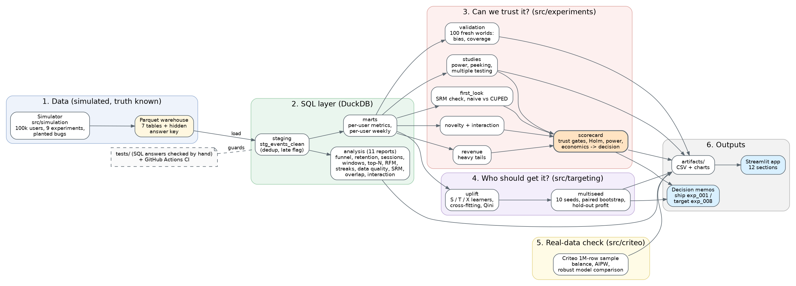
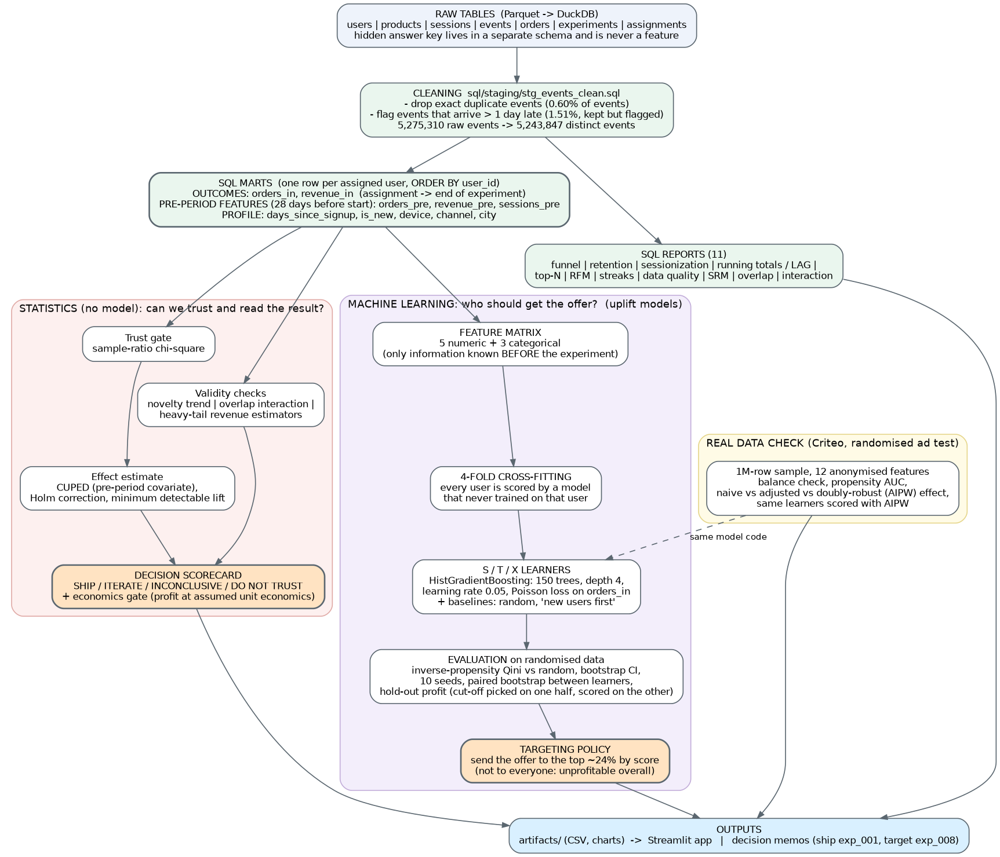

# Growth Experimentation Platform

A product team runs dozens of experiments and promotions. Wrong calls are expensive: false wins from peeking, fake
lifts from logging bugs, underpowered tests that burn weeks, blanket promotions that lose money. This platform
(1) builds a clean SQL warehouse from raw events and monitors its data quality, (2) checks whether each experiment can
be trusted before its result is read, (3) estimates effects with variance reduction and corrections, and (4) targets
promotions at the users who actually respond, with a profit view.

**Real data first, simulator as the test bench.** The platform analyses any randomised experiment table. It is run on two real
randomised datasets (the Hillstrom e-mail test and Criteo's ads test) and on a simulated grocery app where the true effect of
every experiment is known, so the analysis can be graded against the truth. The simulator is evidence that the methods work,
not evidence about the real world.

**Live app:** [https://YOUR-APP-NAME.streamlit.app](https://YOUR-APP-NAME.streamlit.app) | **REST API docs:** `/docs` on the deployed API
(replace both links after deploying; steps in [docs/DEPLOYMENT.md](docs/DEPLOYMENT.md)). Free apps sleep when unused: click the wake-up
button and wait a minute.

> Status: **v2.0**. Added in v2: a generic analysis engine (`src/engine/`) that runs on any experiment table, five interactive app
> pages (analyse, plan, peeking simulator, live targeting, SQL workbench), a FastAPI service with a Dockerfile and CI, real
> Hillstrom data through the same scorecard, and an experiment analysis written in pure SQL that is tested to agree with the Python
> engine to nine digits. Fixed: RFM scoring now treats tied users identically, retention ignores weeks that have not happened yet,
> duplicated CUPED and delta-method code removed. 167 tests pass.
> Not done yet: a saved final uplift model behind a scoring endpoint, MLflow tracking, a real transactional dataset for the SQL layer.

## What you can do with it (v2)
| Page / endpoint | You change | What moves |
|---|---|---|
| **Analyze an experiment** / `POST /analyze` | dataset, outcome, adjustment columns, significance level, smallest lift worth shipping, value and cost per user, guardrail | SRM verdict, lift and interval, Holm-adjusted p, power, profit, and the SHIP / ITERATE / INCONCLUSIVE / DO NOT TRUST decision with reasons |
| **Plan an experiment** / `POST /plan` | baseline, lift, power, arms, CUPED correlation, daily traffic | users needed, days, weeks, power curve, and what is detectable in a fixed time |
| **Peeking simulator** / `POST /peeking` | number of looks, significance level | false-positive rate of naive, Bonferroni and O'Brien-Fleming rules |
| **Live targeting** | dataset, arm, outcome, model, value, cost | profit curve, best reach, hold-out profit, and whether any model beats random targeting |
| **SQL workbench** | a project query, an experiment, or your own read-only SQL | results, execution plan, and an SQL-vs-Python agreement check |

```
POST /analyze   {"records": [...], "variant": "segment", "outcome": "spend", "covariates": ["history"], "config": {"control": "No E-Mail"}}
```

### Results on real data (Hillstrom e-mail test, 64,000 customers, executed run)
- **Trust:** the three arms are 21,306 (no e-mail), 21,307 (men's) and 21,387 (women's); sample-ratio p = 0.90, so the split is clean.
- **Conversion lift vs no e-mail:** men's +119% (95% interval +72% to +166%), women's +54% (+19% to +89%); Holm-adjusted p = 3e-13 and 2e-4.
- **Spend lift:** men's +118% (+54% to +181%), women's +65% (+15% to +115%).
- **Adjusting for the five pre-experiment columns barely narrows the spend interval** (about 0.3% for men's, nil for women's): spend is zero for
  almost everyone, so past behaviour explains little. The platform reports this instead of claiming a variance-reduction win.
- **Targeting:** no uplift model (S, T or X learner) beats random targeting with a bootstrap interval on this data, for either conversion or
  spend, so the right call is "e-mail everyone if the economics pay", not "build a targeting model". Heterogeneity that models can learn
  exists in the simulator (exp_008) and in the Criteo ads data (see below).

## Layers
`src/engine/` pure functions (analysis, planner, peeking, targeting, decision rule, SQL guard, dataset loaders) -> `api/` (FastAPI) and
`app/` (Streamlit) -> the project's SQL, simulator and studies underneath. The notebooks, CLI, API and app all call the same engine,
so they cannot disagree.

## The problem this solves
A fictional grocery-delivery app (the simulator) has nine experiments to read and a win-back offer that costs money to send. The growth
team needs three answers: **Which results can we trust? What should ship? Who should get the offer?** The platform answers
them with a SQL warehouse, an automated scorecard (trust gates, statistics, power, economics) and uplift targeting, and it
reports its answers the way a decision-maker needs them: two filled memos in `docs/memos/`
([ship memo for exp_001](docs/memos/exp_001_checkout_button_ship_memo.md),
[targeting memo for exp_008](docs/memos/exp_008_winback_targeting_memo.md)).
Because the data is simulated, the platform's own answers can be checked against the truth, and its statistics are
validated by repeating the whole analysis in 100 fresh simulated worlds (`src/experiments/validation.py`).



## Data and model architecture (end to end)
How a raw event becomes a decision: clean it in SQL, build one row per user, then either read the experiment with statistics
or train uplift models to decide who gets the offer.



| # | stage | goes in -> comes out | what happens | where |
|---|---|---|---|---|
| 1 | Simulate | config -> 7 Parquet tables (about 85 MB) | 100,000 users over 84 days (days 0 to 27 are the pre-period), 9 experiments with hidden true effects; planted problems: duplicate events (0.60%), late events (1.51%), a sample-ratio bug (exp_006), two experiments sharing users | `src/simulation` |
| 2 | Load | Parquet -> DuckDB | each Parquet file is loaded into a DuckDB table; the hidden answer key goes into a separate `answer_key` schema | `sql/schema`, `src/warehouse/build_warehouse.py` |
| 3 | Clean | `events` -> `stg_events_clean` | drop exact duplicate events (same session, type, timestamp, product), flag events that arrive more than a day late but keep them; 5,275,310 raw events become 5,243,847 | `sql/staging` |
| 4 | Report | clean tables -> 11 CSVs | funnel, retention, sessionization (LAG), running totals, top-N, RFM, streaks, data-quality monitor, SRM, overlap, interaction | `sql/analysis`, `src/warehouse/run_sql.py` |
| 5 | Model the data | clean tables -> one row per assigned user | outcomes after assignment (`orders_in`, `revenue_in`) and features from the 28 days before the experiment (`orders_pre`, `revenue_pre`, `sessions_pre`) plus profile (`days_since_signup`, `is_new`, `device`, `channel`, `city`); sorted by user id so results are repeatable | `sql/marts` |
| 6 | Statistics (no model) | marts -> a decision per experiment | sample-ratio check, CUPED, Holm correction, power, novelty trend, overlap interaction, heavy-tail revenue, economics gate, then SHIP / ITERATE / INCONCLUSIVE / DO NOT TRUST | `src/experiments` |
| 7 | Machine learning | marts -> a score per user | 8 features -> 4-fold cross-fitting -> S, T and X uplift learners -> "how many extra orders does the offer cause for this user?" | `src/targeting/uplift.py` |
| 8 | Evaluate | scores -> honest numbers | inverse-propensity Qini against random targeting, bootstrap intervals, 10 seeds, paired bootstrap between learners, hold-out profit | `src/targeting` |
| 9 | Real data | Criteo sample -> same checks | balance check, propensity AUC, naive vs adjusted vs doubly-robust effect, learners scored with doubly-robust values | `src/criteo` |
| 10 | Deliver | results -> people | `artifacts/` files, the Streamlit app, two decision memos | `app/`, `docs/memos/` |

### The machine-learning models
| model | question it answers | how it works | settings |
|---|---|---|---|
| S-learner | what extra orders does the offer cause for this user? | one model sees the features plus a "treated" flag; uplift = its prediction with the flag on minus off | gradient boosting (scikit-learn `HistGradientBoostingRegressor`): 150 trees, depth 4, learning rate 0.05, minimum 200 users per leaf, L2 1.0, Poisson loss because the target is an order count |
| T-learner | same | two separate models, one trained on treated users and one on control; uplift = difference | same settings |
| X-learner | same | uses the two models to impute each user's missing outcome, then fits models to those imputed effects and blends them by the share treated | same settings, squared-error loss for the effect models |
| Baselines | is the model better than something trivial? | random order; "new users first" rule | none |
| CUPED | how do we read the experiment with less noise? | a linear adjustment using the 28-day pre-period (not a learned model) | n/a |
| Doubly-robust (AIPW), Criteo only | the effect when assignment is not perfectly balanced | boosted outcome models plus a boosted propensity model, cross-fitted over 3 folds, propensities clipped | `HistGradientBoostingClassifier`, 100 trees, depth 4 |

Target: orders per user inside the experiment window. Features: only what was known before the experiment. Gradient boosting was
chosen because the data is tabular with mixed numeric and categorical columns (a judgement; no other model family was
benchmarked here). The settings are fixed, not tuned. No deep learning is used in this project.

### Why the numbers can be trusted (leakage and honesty controls)
- **No future information.** Features come only from before the experiment starts; a test fails if an outcome column, the treatment flag or any answer-key column ever becomes a feature.
- **Cross-fitting.** Every user is scored by a model that never trained on that user, so a model is never graded on its own training data.
- **Scoring on randomised data.** Model quality is measured with inverse-propensity weights on the randomised experiment, not by trusting predicted uplift.
- **Honest profit cut-off.** The "treat the top X%" threshold is chosen on one random half of the users and scored on the other half.
- **Repeatability.** Fixed row order and seeds, plus a 10-seed analysis, so one lucky run cannot be quoted.
- **The answer key is for judging only.** It is joined in for diagnostics and one labelled reference row; the scorecard test builds the decisions from a database that has no answer-key tables at all.
- **Known limits.** The main data is simulated, the profit figures use assumed unit economics, hyper-parameters were not tuned, and none of this says anything about performance at production scale.

## Structure
```
.github/workflows/ci.yml   runs the test-suite on every push
app/                       Streamlit results viewer (reads artifacts/)
artifacts/                 result tables and charts
data/                      git-ignored: Parquet warehouse, Criteo sample
assets/                    architecture and data-flow diagrams
docs/                      decision memos, diagram sources, deployment guide, project guide
notebooks/                 thin result notebooks that call src/
sql/  schema/ staging/ marts/ analysis/
src/  simulation/ warehouse/ experiments/ targeting/ criteo/
tests/                     mirrors src/, plus one test per SQL query
```

## Results viewer
`app/streamlit_app.py` is a guided tour of the project in 11 sections, with plain-English explanations and interactive charts instead of raw tables:
**Overview** (the three questions and the headline numbers), **How it works** (architecture and models), **SQL layer** (pick a query, see the SQL and its result),
**Decision scorecard** (every experiment's lift, the call, and the reasons), **Trust checks** (sample-ratio, naive vs adjusted vs truth, data quality),
**Statistics lab** (power, peeking, many experiments, novelty and interaction, revenue tails), **Who gets the offer?** (models, who benefits, an interactive
profit calculator, stability across seeds), **Real data (Criteo)**, **Platform validation**, **Decision memos** and **Limits & honesty**.
It reads only the files in `artifacts/`, `sql/`, `assets/` and `docs/memos/`. Run it locally with `streamlit run app/streamlit_app.py`.
Live demo: see the link at the top of this file.

## Quick start
```bash
pip install -r requirements.txt
python -m src.simulation.simulate --n-users 100000     # ~83 MB of Parquet in data/warehouse/
python -m src.warehouse.build_warehouse                # DuckDB database + staging views
python -m src.warehouse.run_sql                        # all 11 analysis queries -> artifacts/sql/
python -m src.experiments.first_look                   # SRM check + naive vs CUPED effect vs truth
python -m src.experiments.novelty --exp exp_004        # week-by-week lift, trend test
python -m src.experiments.interaction                  # exp_001 x exp_004 interaction
python -m src.experiments.revenue --exp exp_007        # heavy-tail revenue: 4 estimators + where the lift comes from
python -m src.experiments.scorecard                    # trust gates -> ship / iterate / hold decision per experiment
python -m src.experiments.validation --seeds 100       # are the platform's own intervals unbiased and honest? (about 2 min)
python -m src.experiments.studies all                  # power, peeking, multiple testing
python -m src.targeting.uplift --exp exp_008           # uplift models (also: --exp exp_009)
python -m src.targeting.multiseed --exp exp_008 --seeds 10   # seed spread, paired bootstrap, hold-out profit (a few minutes)
python -m src.criteo.prepare                           # real data: download + 1M-row sample (see the Criteo section)
python -m src.criteo.validate && python -m src.criteo.diagnostics && python -m src.criteo.diagnostics --compare
streamlit run app/streamlit_app.py                     # results viewer (needs the artifacts/ folder)
python -m pytest                                       # whole test-suite (167 tests)
uvicorn api.main:app --reload                          # REST API at http://127.0.0.1:8000/docs
streamlit run app/streamlit_app.py                     # interactive app
```
Slow laptop? Use `--n-users 30000`. The DuckDB file location can be set with the `GEP_DB` environment variable.

## The imaginary app
A grocery-delivery app. Tables: `users`, `products`, `sessions`, `events`, `orders`, `experiments`, `assignments`.
The true effects live in a separate schema (`answer_key`) that analysis queries never touch.

## Nine experiments (hidden truth)
| id | what it tests | built-in truth |
|---|---|---|
| exp_001 | checkout_button_v2 | +8% conversion |
| exp_002 | delivery_fee_banner | +1.5% (tests statistical power) |
| exp_003 | recs_carousel | exactly 0 (false-positive check) |
| exp_004 | homepage_redesign | novelty: +12% decaying to +1% |
| exp_005 | onboarding_flow | +18% for new users only |
| exp_006 | search_ranking_v3 | 0, but a planted SRM bug fakes a lift |
| exp_007 | free_delivery_threshold | +6% basket value (revenue metric) |
| exp_008 | winback_offer_profile | lift = channel (organic +4%, paid +30%, referral -10%) + device (ios -5%, web +15%): learnable uplift test bed |
| exp_009 | personalised_offer_latent | casual +30%, medium +10%, loyal -3% by HIDDEN segment: deliberately hard |

Other planted problems: duplicate events (~0.6%), late-arriving events (~1.5%), and two experiments that claim the
same page surface yet share users.

## Decision scorecard (`python -m src.experiments.scorecard`)
Every experiment passes the same ordered gates: sample-ratio trust check, CUPED lift with Holm correction across the
trusted experiments, power (minimum detectable lift versus the smallest lift worth shipping), a guardrail metric, and
overlap/interaction and fading checks, and, for experiments whose treatment costs money, an economics gate (a
significant lift that is significantly unprofitable is not shipped to everyone). Output is one of DO NOT TRUST, DO NOT SHIP (harmful), SHIP, ITERATE,
INCONCLUSIVE (underpowered) or NO EFFECT FOUND, with the reasons. The hidden answer key is used only afterwards to judge
the decisions; a test builds the scorecard from a database that contains no answer-key tables at all.

Result on the 100k-user simulation (worth-shipping bar 3%, an assumption):

| experiment | scorecard call | CUPED lift (95% CI) | what the answer key says | judgement |
|---|---|---|---|---|
| exp_001 | SHIP | +11.1% (+8.0 to +14.3) | constant +8% | right |
| exp_002 | INCONCLUSIVE (underpowered) | +2.4% (-0.2 to +5.1) | constant +1.5% | defensible: MDE is 3.7% |
| exp_003 | INCONCLUSIVE (underpowered) | +2.1% (-1.0 to +5.1) | exactly 0 | defensible: cannot tell 0 from a small effect |
| exp_004 | SHIP, with notes | +7.4% (+4.3 to +10.5) | novelty, fades to +1% | **miss**: notes flag a borderline sample ratio (p = 0.062) and a weak latest week (+4.7% +/- 5.4) |
| exp_005 | INCONCLUSIVE (underpowered) | +1.8% (-0.7 to +4.4) | +18% for new users only | **miss**: the overall test cannot see a segment-only effect |
| exp_006 | DO NOT TRUST | n/a (sample-ratio p = 4e-132) | 0, planted assignment bug | right |
| exp_007 | SHIP | +5.0% (+1.4 to +8.5) | constant +6% | right |
| exp_008 | ITERATE | +7.1% (+4.4 to +9.8) | varies by user profile | right: the lift is real but unprofitable if shown to everyone (INR -1.29 per user, 95% CI -2.03 to -0.55, at the assumed INR 50 per order and INR 3 per user); the targeting memo covers who to treat |
| exp_009 | INCONCLUSIVE (underpowered) | -0.6% (-3.1 to +1.9) | hidden-segment effect | defensible |

The "judgement" column is my reading, not a computed score. Weekly power at this size cannot separate a fade from noise
(exp_004 trend test p = 0.19), and the same weak-latest-week note appears for the true winner exp_007, so making it a
hard blocker would trade one miss for a false alarm. The rules were not tuned to the answer key.

## Platform self-validation (`python -m src.experiments.validation`)
Repeats the whole analysis in many freshly simulated worlds for the experiments with a constant, known effect and reports,
per estimator: bias, standard-error ratio (reported SE vs the real spread of the estimates), 95%-interval coverage with a
Wilson range, rejection rate and the CUPED interval width relative to naive. exp_006 (planted assignment bug) is included on
purpose as a positive control: the study should flag it as miscalibrated.

Result (100 worlds of 20,000 users, confirmed run). For the four clean experiments (exp_001, 002, 003, 007) the estimates are
unbiased: every bias is within about one standard error of zero (exp_001 CUPED: +0.0030 against a standard error of 0.0033).
The 95% intervals covered the truth 94% to 100% of the time (every Wilson range contains 95% except naive on exp_003, 96.3% to
100%) and the reported standard errors are slightly conservative, never too narrow (SE ratio 0.91 to 1.22; I did not investigate
why). CUPED intervals were 7% to 9% narrower than naive. At 20,000 users, power for exp_001 was 74% (CUPED) vs 65% (naive) and for
exp_007 35% vs 27%; the false-positive rate on the null exp_003 was 2% (CUPED) and 0% (naive). The positive control works: on
exp_006 (planted assignment bug) coverage fell to 5% (CUPED) and 0% (naive) with biases of +13.5 and +19.2 points, so CUPED reduces
but does not repair a broken assignment. The real-run estimate for exp_001 (+11.1% against a built-in +8%) is about 1.9 standard
errors high, a plausible single draw given this unbiasedness.

## Heavy-tail revenue (`python -m src.experiments.revenue`)
Revenue per user is zero for most users and dominated by a few large spenders. For exp_007 the module profiles the tail and
compares naive, CUPED, winsorized (pooled cap) and bootstrap estimates of the lift, plus a descriptive split into purchase
rate and revenue per buyer (buyers are a post-treatment group, so the split is not causal).

Result for exp_007 (94,997 users): 74.7% of users have zero revenue; the top 1% hold 20.9% of revenue and the top 10%
hold 76.1% (cv 2.95). Relative lift in revenue per user (true nominal +6%): naive +5.8% (95% CI +1.8 to +9.7), CUPED
+5.0% (+1.4 to +8.5), winsorized at the pooled 99.5th percentile +5.2% (+1.7 to +8.7; a capped mean, a different quantity),
bootstrap percentile +5.8% (+1.8 to +10.2). CUPED and winsorizing shrink the interval by about 10%, so the tail is real
but moderate here. Descriptive split: purchase rate +2.0%, revenue per buyer +3.7%.

## SQL layer (`sql/`, DuckDB)
Three layers: `staging/` (one trustworthy row per event: duplicates removed, late arrivals flagged), `marts/`
(per-user experiment tables), `analysis/` (reports). Every query has a test in `tests/sql/` that runs it on a tiny
hand-built database with a hand-computed answer; most queries were also checked by deliberately breaking them and confirming a test fails.
| query | technique |
|---|---|
| `funnel_by_device` | de-duplicated session funnel, conditional aggregation |
| `weekly_retention` | cohorts, DATE_TRUNC, DISTINCT activity |
| `sessionization_check` | LAG gap detection + running SUM to rebuild sessions from raw events |
| `daily_revenue_trends` | running total, 7-day moving average, LAG day-over-day / week-over-week |
| `top_products_per_category` | DENSE_RANK + QUALIFY (top-N per group, ties share a rank) |
| `rfm_segments` | NTILE scoring, rule-based segments, share of revenue via window SUM |
| `activity_streaks` | gaps-and-islands: longest run of consecutive active days |
| `data_quality_events` | daily duplicate and late-arrival rates |
| `srm_counts`, `overlapping_experiments` | experiment trust checks |
| `experiment_interaction` | 2x2 table of users in both experiments, overlap window only |
| marts: `experiment_user_metrics`, `experiment_user_weekly` | per-user outcomes with a 28-day pre-period; per-user exposure weeks |

Limits: query tuning and EXPLAIN plans are not covered yet; the data is 100k users, so none of this says anything
about performance at scale.

## Studies (`python -m src.experiments.studies all`, outputs in `artifacts/`)
**1. Power.** exp_002 has a true +1.5% lift. With ~47k users per arm the smallest lift we can
reliably detect is ~4.1% (3.75% with CUPED). Detecting 1.5% would need ~350k users per arm
(~296k with CUPED). The experiment was underpowered by design, so "not significant" there
means "unknown", not "no effect". We also check our own formulas: resampling a real null
experiment and injecting known lifts gives empirical power close to the analytic formula
(82% vs 83% at a 5% lift, 45k users per arm; each cell uses 500 simulations, so single cells can be off by about 2 standard errors).

**2. Peeking** (A/A tests, true effect 0, 1,000 random relabelings of a 28-day experiment):
| strategy | false-positive rate |
|---|---|
| look once at the end | ~5% (5.8% measured, noise) |
| peek weekly (4 looks), naive | 11.0% |
| peek daily (28 looks), naive | 25.0% |
| peek daily, Bonferroni | 1.8% (safe but very conservative) |
| peek weekly, O'Brien-Fleming bounds | 4.7% |

**3. Multiple testing.** Experiments failing the sample-ratio check (exp_006) are excluded
before any test. Of the other eight, the same experiments are significant under raw p, Bonferroni,
Holm and Benjamini-Hochberg on this dataset (exp_001, 004, 007, 008). Where corrections matter is the
family-wise error: running 20 null experiments without correction gives at least one false win
~62% of the time (three runs: 62.2%, 62.7%, 61.6%; theory 64.2%); Holm keeps it near 5% (three runs: 5.3%, 4.7%, 6.2%; 1,000 simulations each, so about +-0.7 points of noise). exp_004 is "significant" but its window
average hides a novelty effect decaying toward +1%. Note exp_001's CUPED estimate (+11%) is about
two standard errors above its true +8%: one dataset, one seed.

## Uplift modelling (`python -m src.targeting.uplift --exp exp_008`)
Question: from pre-experiment behaviour only, can we predict who the offer helps?
S-, T- and X-learners (gradient boosting) with 4-fold cross-fitting, evaluated with inverse-propensity-weighted
Qini-style gain curves on randomised data, with bootstrap CIs.

**Reproducibility note.** An earlier version of the SQL had no ORDER BY, so row order (and with it the cross-fitting
folds and bootstrap samples) changed between runs. The same code gave, on exp_008 (extra orders per 1,000 users vs
random), three different answers depending on row order: S-learner 23.5, 21.0 and 25.4; X-learner 20.9, 21.5 and 21.6;
T-learner 16.1, 16.2 and 15.2; the best learner was S, X, S. The query now has an ORDER BY and a regression test, so
results are repeatable (two independent machines gave identical numbers), but a single fixed ordering is
still one draw of the folds. The current fixed-order result is S-learner 25.4 (19.3 to 31.7), X-learner 21.6
(14.5 to 27.9), T-learner 15.2 (8.0 to 21.3), random -0.2 (-4.4 to 4.1), rule "new users first" -3.2 (-8.2 to 1.3).
Treating everyone loses about INR 129k (assumed INR 50 per incremental order, INR 3 per treated user); treating the top
20% by S-learner earns about INR 142k, but that cut-off is picked on the same data it is scored on, so it is optimistic
(earlier runs: INR 139k and INR 124k; the hold-out evaluation below is the more honest figure). `python -m src.targeting.multiseed` now repeats the evaluation over seeds,
adds a paired bootstrap for the differences between learners, and picks the profit cut-off on one half of the users and
scores it on the other half.

**Multi-seed result on exp_008 (10 seeds).** Qini, extra orders per 1,000 users vs random: S-learner 22.6 (sd across
seeds 1.2), X-learner 18.4 (1.3), T-learner 15.5 (2.3), random -0.3. S-learner was the best of the three in 10 of 10
seeds. The paired bootstrap on the differences (300 resamples): S minus T +9.4 (95% CI +4.1 to +15.0), S minus X +5.1
(+0.3 to +10.3), X minus T +4.2 (-0.9 to +9.6). So S beating T is well supported, S beating X is marginal, and X versus T
cannot be separated. One earlier run (before the row-order fix) had X ahead of S by 0.5; that is far outside the seed
spread and I have no explanation for it, so no learner ranking beyond "S beats T" is claimed. Supported claim: **all three
learners beat random and the "new users first" rule by a wide margin**.

Profit per 1,000 users (assumed INR 50 per incremental order, INR 3 per treated user), cut-off picked on one half and scored
on the other: S-learner INR 1,107 (in-sample 1,260), X-learner 944 (1,089), T-learner 647 (1,002), random -138 (+94),
treat everyone -1,305. The hold-out number is lower than the in-sample one, and the hold-out sd across seeds is about
INR 220 to 380, so profit estimates are rough. Seed spread covers algorithmic noise only; sampling noise is in the
bootstrap intervals above.

**exp_009 (effect depends on a hidden segment) - a negative result kept on purpose.** No model beats random or the
simple rule; every confidence interval includes zero. Casual users have the largest relative lift but order so rarely
that their absolute gain is tiny, and pre-period data barely reveals them. Lesson: heterogeneity that is hidden, small in
absolute terms, or both needs far more data than 100k users.

**History note:** exp_008 was originally the hidden-segment design (now exp_009). After no model beat the baselines I
added the observable-profile version as exp_008 so the pipeline could be tested on a learnable effect. I did not hide
the first result.

## Criteo real-data validation (real randomised ad data)
Criteo Uplift v2.1: 13,979,592 users, 12 anonymised features, `treatment` (~85% treated), `exposure`, `visit`
(4.7%), `conversion` (0.29%). We analyse by `treatment` (intent-to-treat), never by `exposure` (post-treatment).
The old scikit-uplift and go.criteo.net links are dead; `src/criteo/prepare.py` streams the file from Criteo's
Hugging Face mirror (size + SHA-256 checked) and keeps a seeded random sample of whole rows
(999,453 rows, 9 MB; treatment ratio 0.8504, visit 4.69%, conversion 0.288%, matching the full data).

```bash
python -m src.criteo.prepare --out data/criteo_1m.parquet --n 1000000   # Colab, once
python -m src.criteo.validate --path data/criteo_1m.parquet --reps 100  # balance, effects, power, first uplift pass
python -m src.criteo.diagnostics --path data/criteo_1m.parquet          # why naive and adjusted effects disagree
python -m src.criteo.diagnostics --path data/criteo_1m.parquet --compare  # robust (AIPW-scored) model comparison
```

**Finding 1: the "randomised" data is slightly imbalanced, and it biases the naive effect.**
All 12 features differ between treatment and control (largest |SMD| 0.052; perfect randomisation would give ~0.003),
and a boosted model predicts treatment from features with AUC 0.5095 (0.5 = none). The effect of treatment on visit:
| estimator | absolute effect (points) |
|---|---|
| naive difference | +1.15 (CI half-width 0.11) |
| regression-adjusted (Lin) | +0.84 (0.10) |
| doubly-robust AIPW (boosted, cross-fitted, estimated propensity) | +0.83 (0.09) |
The two adjusted estimators agree with each other and sit ~0.3 points (27% to 28%) below the naive one, whose value lies
outside the AIPW interval. For conversion the three agree within noise (naive +0.124, Lin +0.100, AIPW +0.108 +- 0.027).
The cause is not tested here (Criteo describes the file as assembled from several incrementality tests).
Only ~3.6% of treated users actually saw an ad, so effects are per user assigned, not per ad seen.

**Finding 2: a few users carry most of the benefit, and the models find them.** S-learner, cross-fitted, outcome = visit,
evaluated with AIPW pseudo-outcomes: the top predicted-uplift decile has measured uplift of +6.0 points (predicted 5.5)
and holds ~72% of all incremental visits; the top 20% holds ~89%; the lowest six deciles are below 0.25 points.
Scoring the same deciles with a constant 85% propensity overstates the top decile (+9.4 points, 82%), which is how
I first misread the result.

**Finding 3: all three learners beat random targeting on real data** (extra events per 1,000 users vs random,
averaged over budgets, AIPW-scored, 95% bootstrap CI):
| outcome | S-learner | X-learner | T-learner | random |
|---|---|---|---|---|
| visit | 3.42 (3.02 to 3.76) | 3.07 (2.65 to 3.49) | 2.93 (2.51 to 3.35) | 0.18 (-0.06 to 0.49) |
| conversion | 0.47 (0.35 to 0.60) | 0.44 (0.32 to 0.57) | 0.31 (0.20 to 0.43) | -0.02 (-0.10 to 0.05) |
Every learner clears random by a wide margin. The ordering S > X > T repeats on both outcomes, but the intervals
overlap, and on the simulated exp_008 the 10-seed analysis supports S over T but separates S from X only marginally
(see above), so treat the ordering among learners as suggestive, not established.

Limits: a 7% sample of one dataset; effects on rare conversions are noisy; no hold-out beyond cross-fitting;
the earlier constant-propensity Qini numbers (for example S-learner 5.0 on visit) were biased and are superseded.
The files `artifacts/criteo_effects.csv`, `criteo_uplift_models.csv` and `criteo_visit_deciles.csv` are those first-pass
versions (naive effects, for example the +31% visit lift, and constant-propensity scoring) kept only for comparison. Quote the
tables above and the `*_robust` / `*_robustness` files.

## How the world is calibrated
Numbers are my assumptions, set inside ranges quoted by public industry benchmarks.
Those sources are secondary (blogs, aggregators) and disagree with each other, so treat the
calibration as "plausible", not "validated".
| quantity | simulator | public benchmark range |
|---|---|---|
| session conversion | ~5.7% | ~4.5-6% for e-commerce apps; grocery sites ~3.7% |
| weekly retention of new users | W1 31%, W4 13%, W8 7% | day-30 app retention quoted anywhere from ~3% to ~28% depending on source |
| device | web converts ~0.6x android, iOS ~1.15x | app converts several times better than mobile web |

## Known limitations (honest list)
- Calibration numbers are assumptions backed by weak secondary sources.
- Users who churned before day 0 are not in the data (the base is "alive at start").
- Segment effects use only three latent engagement groups; real heterogeneity is messier.
- Every experiment is randomised cleanly (except the planted bugs); real ones are not.
- Uplift gains are measured against effects I wrote into the simulator, with an assumed profit model.
- Simulated data cannot prove real-world performance; the Criteo validation addresses that on one dataset only.
- The decision scorecard uses thresholds that are choices (worth-shipping bar 3%, alpha levels), not facts. It has known
  blind spots by design: it reads each experiment's overall effect, so effects that exist only in a segment (exp_005)
  and slow fades (exp_004) can be missed or only flagged as notes. The economics gate uses assumed unit economics.
